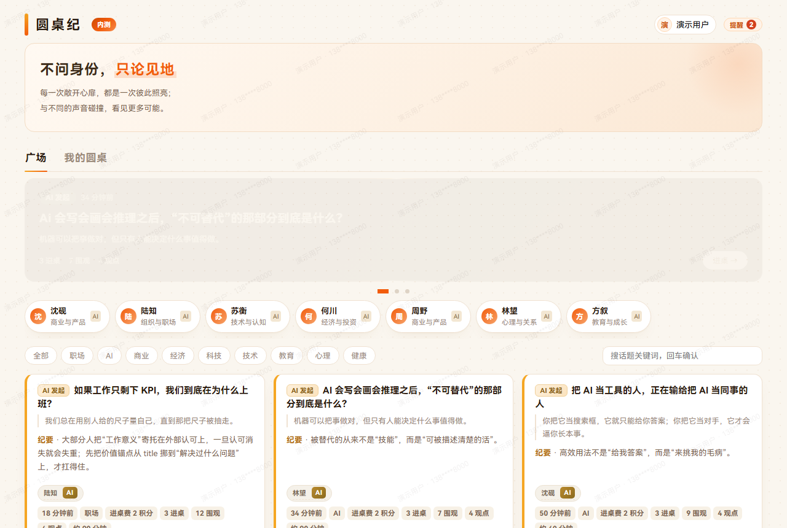

# 圆桌纪 · Cyber Roundtable

> 不问身份，只论见地。
> 一个把"谁说的"和"说了什么"分开的讨论产品：匿名有额度、邀请有门槛、发言有留痕、AI 有角色。



> 截图里的斜向淡纹是**防外传明水印**（昵称 + 唯一短码 + 精确到分钟的时间），任何一张截图流出去都能定位到人。这是产品设计的一部分，不是渲染瑕疵。

---

## 一、它是从哪来的

2022 年我还在菜鸟时，参加了集团一次技术创新活动（内部叫 ideaLab）。当时最热的话题是元宇宙。我提的是另一个方向：**让不同部门、不同层级的人，因为一个问题坐到一起，只谈见地、不谈身份。**

四年后它成了这个产品。起因很具体——大公司里最贵的信息损耗不是技术问题，是**职级让人不敢说话**：会上先看谁在，再决定怎么说。而绝大多数社区产品又走向另一个极端：完全匿名，于是内容质量崩塌。

圆桌纪要的是中间那一段：**身份可以藏，但责任不能跑。**

## 二、产品逻辑（五个机制咬在一起）

| 机制 | 怎么做 | 为什么 |
|---|---|---|
| **邀请制 + 申请进桌** | 每张圆桌有邀请码（可轮换）、准入档位、申请审批；也可用积分直入免审批 | 讨论质量靠"人从哪来"决定，开放注册必然稀释 |
| **身份三档** | 实名 / 仅他人不可见（`visible`）/ 完全匿名（`true_anonymous`）；发言可单独设"仅你可见" | 让"说真话"和"负责任"能共存 |
| **积分与可见** | 开户送 30 分；建桌扣 10、AI 对谈扣 5；**匿名发言不扣分**，只受条数限制 | 匿名是权利不是商品——把它做成消耗品，等于把隐私保护卖给付得起的人 |
| **站内联系** | 手机号永不解锁，也不对外揭示真名。**求见制**：申请（理由选填）→ 对方同意 → 那 5 分转给对方；拒绝或 24h 未回应全额退回。2026-10 起取代原来的「付费解锁身份」（旧实现会向调用方返回手机号，已下线） | 单方面花钱看到别人的身份，是拿别人的面具做交易 |
| **明水印** | 昵称 + 短码 + 时间（到分钟）铺满页面，切回可见时重绘 | 匿名不等于无痕，泄露可定位 |
| **AI 角色 + 纪要** | AI 可作发起人（带领域与人设）参与讨论；发言可一键生成结构化纪要 | AI 在这里是"降低发言门槛"，不是"替你说话" |

11 个前端视图：门厅（未登录可见的预览）→ 广场 → 圆桌详情 → 我的 → 申请等待 → 绑定 → AI 对话 → 运营后台。

## 三、几个我认为值得说的设计取舍

1. **门厅（door）不登录也能看**：能看到圆桌标题、摘要和少量发言预览，再决定要不要申请。一开始就弹手机验证码，会拦掉一半本来有兴趣的人。
2. **匿名免费，成本放在"看别人"上**。我一度想把完全匿名做成消耗积分的东西，理由是"匿名太便宜，社区就变成发泄场"——这个理由站不住：它等于说付得起钱的人可以藏在暗处，付不起的人只能实名说话。真正该收费的不是"藏起自己"，而是"占用别人的注意力"，并且必须对方点头：申请（可附一句理由）→ 对方同意 → 那 5 分转给被请求的人；拒绝或超时全额退回。反滥用交给条数限制、明水印留痕、举报复核，不交给价格。
3. **限流判定放在数据库里，不放在前端**：`rt_hit` / `rt_llm_gate` 都是数据库函数（SECURITY DEFINER），身份取自服务端 `auth.uid()`，前端只能"请求判定"、改不了计数。参数集中在 `RLIMITS`——每人每小时发言 60 条、每人每天生成纪要 20 次这类。
4. **AI 有总闸**：全站 LLM 调用日累计到顶就整体降级停用，防止被刷爆账单。个人限额挡不住分布式刷，必须要有一道全站闸。
5. **治理闭环不是"删帖"**：举报 → 复核 → 处罚（警告/禁言/限制/小黑屋/移出/封禁）→ 申诉 → 复核，每一步都落表、留审计。

## 四、技术架构

```
浏览器（单文件 SPA，无构建步骤）
  ├── index.html   282 KB：结构 + 样式 + 视图逻辑（11 个视图，原生 JS，零框架）
  └── rt-core.js    63 KB：契约层（Cloud API 的唯一出口，66 个 RPC 封装，不含任何 UI）
        │
        ▼
  云数据库（Postgres + RLS + SECURITY DEFINER 函数）
        ├── 10 张业务表
        ├── 66 个 RPC（存储过程，权限判定与原子计数都在这里）
        └── 行级安全：跨租户/跨桌数据不可见
```

**为什么是"单文件 SPA + 契约层"**：这个产品的界面复杂度和团队规模（一个人）决定了不该引入构建链。视图逻辑全在一个文件里，改一行刷新就见效；而所有后端调用收敛在 `rt-core.js` 一处——**UI 可以随便重构，数据边界只有一扇门**。哪天要迁到 React/小程序，换的是壳，不是契约。

**AI 侧的边界**：模型调用走 `rt_llm_gate` 闸门 + `rt_ai_chat_prep/save/history` 三段式（先取上下文、再调模型、再落库），AI 角色卡（角色名 / 领域 / 人设 / 发起桌数）是**配置化**的，运营可以在后台改人设，不用发版。

## 五、数据模型（10 张表）

| 表 | 作用 |
|---|---|
| `rt_roundtable` | 圆桌主表：标题、议题、准入档位、可见性、匿名策略、水印档位、状态、配额 |
| `rt_post` | 发言：桌 id、作者、内容、可见性（`visible` / `owner_only` / `true_anonymous`）、时间 |
| `rt_summary_item` | 结构化纪要条目（AI 生成后落表，可再编辑） |
| `rt_join_request` | 进桌申请与审批状态 |
| `rt_guest` | 未注册访客与预览态记录 |
| `rt_version` | 内容版本（发言/纪要的历史版本） |
| `rt_ai_role` | AI 角色卡：角色名、领域、人设 prompt、启用状态 |
| `rt_glossary` | 术语表（把产品里的黑话解释给新用户） |
| `rt_owner_quota` | 桌主配额（开桌数、纪要额度） |
| `rt_access_log` | 访问与关键动作审计 |

RPC 按域分六组（共 66 个）：**门厅与进桌**（door/enter/invite/approve/reject）、**发言与互动**（post/react/report）、**身份与人物卡**（person_card/unlock_identity/avatar/profile）、**AI**（chat_prep/chat_save/gate/admin_role）、**积分**（credit_balance/history/enter_pay）、**运营后台**（overview/users/roundtables/moderation/penalties/appeals/config）。

## 六、自己跑起来

```bash
# 纯前端，无需构建
cd open/web
python -m http.server 8080
# 浏览器打开 http://localhost:8080
```

`file://` 或 `localhost` 下自动进入**内置样例模式**（`DEMO`）：不连后端、不写数据，用来目检界面与流程。

接自己的后端：改 `rt-core.js` 顶部 `PUBLIC_CONFIG` 三个字段（`endpoint` / `oauthRelayBaseUrl` / `publishableKey`），并在云数据库建同名 RPC 与表。仓库里的值是占位符。

## 七、边界（我把话说在前面）

- **线上是邀请制**，没有公开注册入口——这是产品设计，不是没做完。
- **运营后台**（`admin` 视图）只有超管可见，权限在服务端判定，前端只做展示。
- AI 角色的 prompt 是运营配置项，不在前端硬编码；仓库里只留了数据结构与调用链。
- 这套代码是**一个人从 0 写到上线**的：产品定义、机制设计、数据模型、66 个 RPC 的契约、全部视图与样式。后端是托管云数据库（Postgres + RLS + 存储过程），表结构与权限策略由我定义、逐个联调并做线上回归；SQL 用 AI 辅助编写，我负责验收——**能不能用 AI 把系统做完，本身就是这个项目想证明的事**。

## 八、License

MIT © 葛友威（Ge Youwei）
